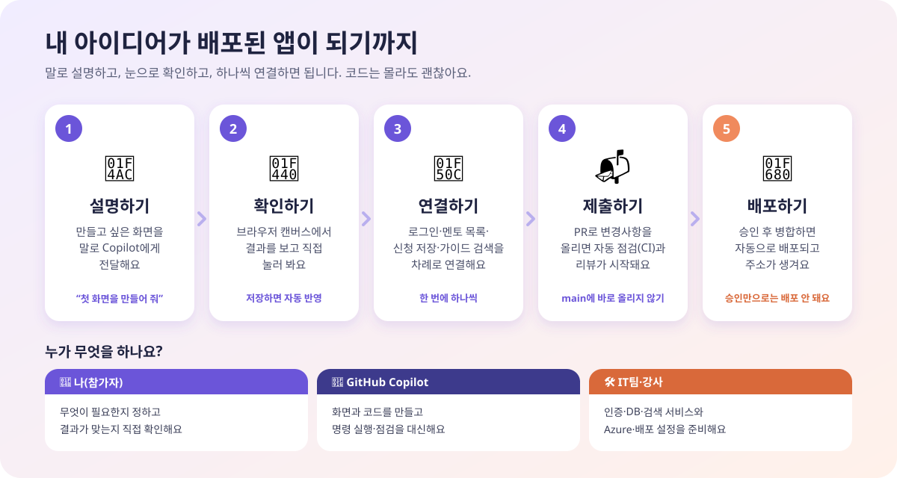
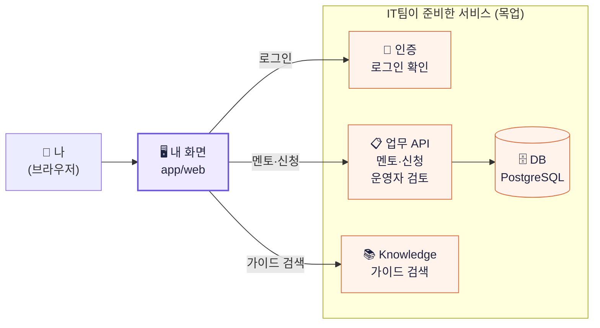
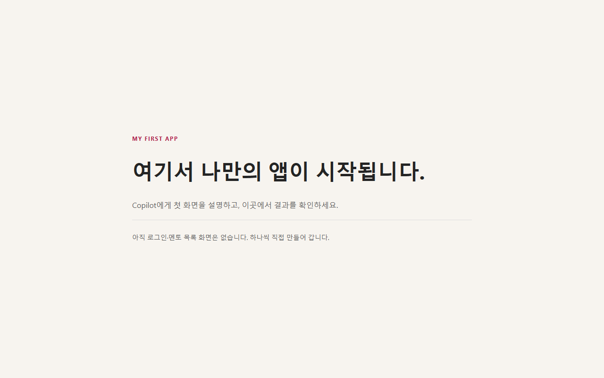
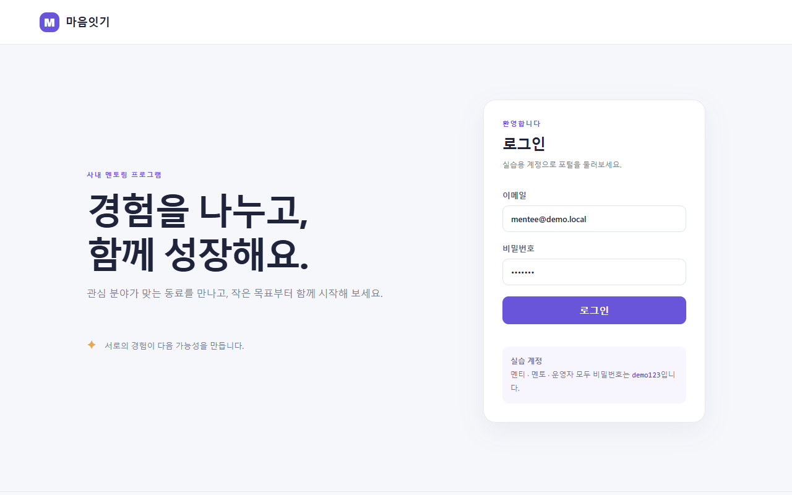
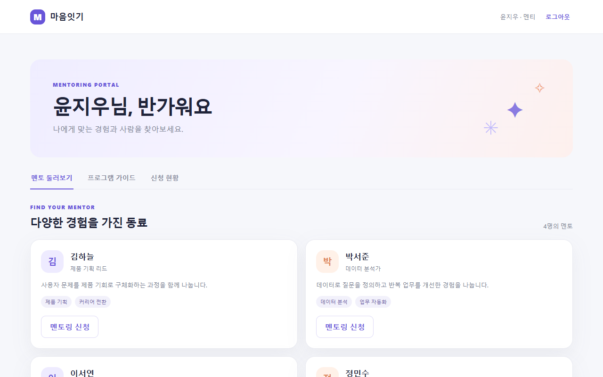
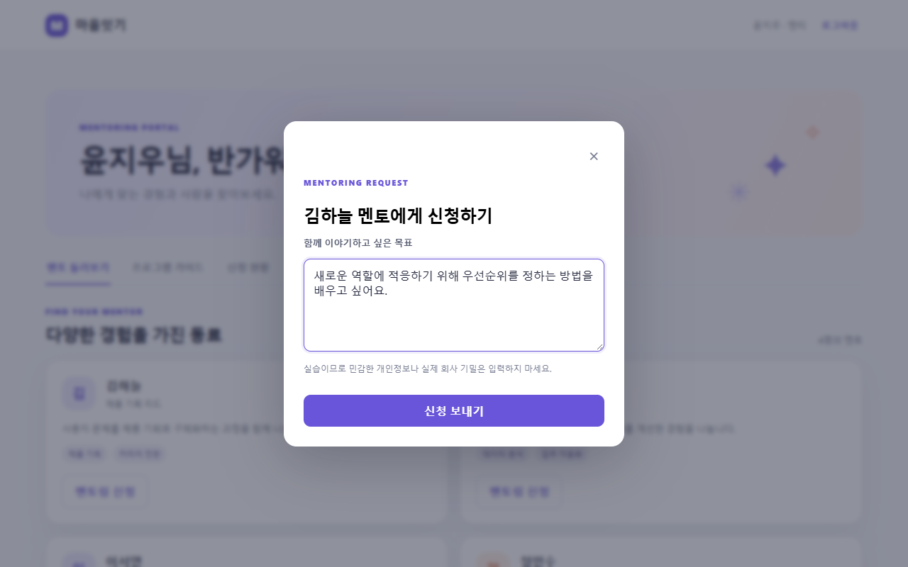
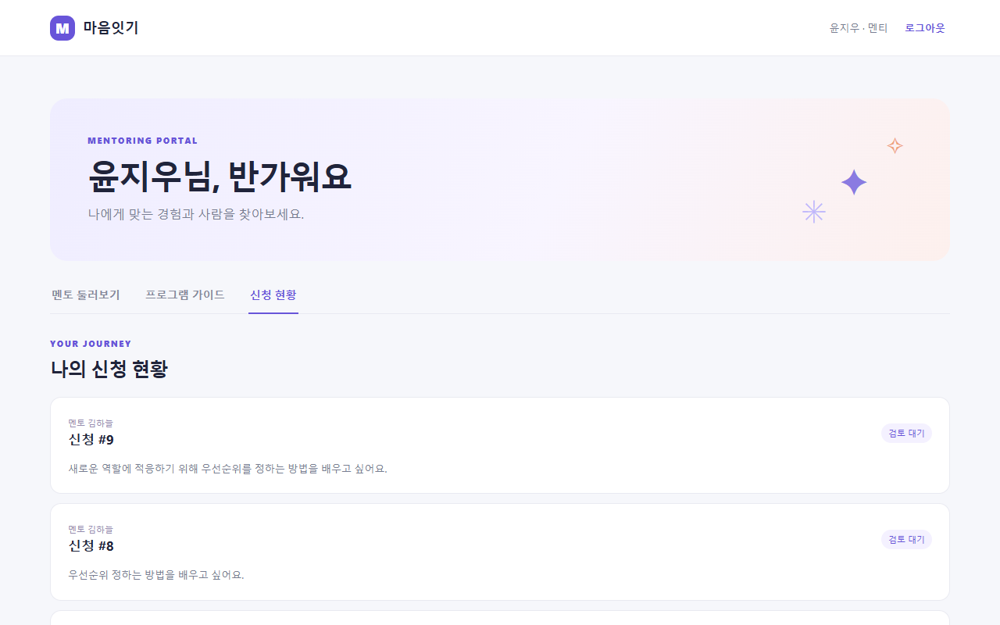
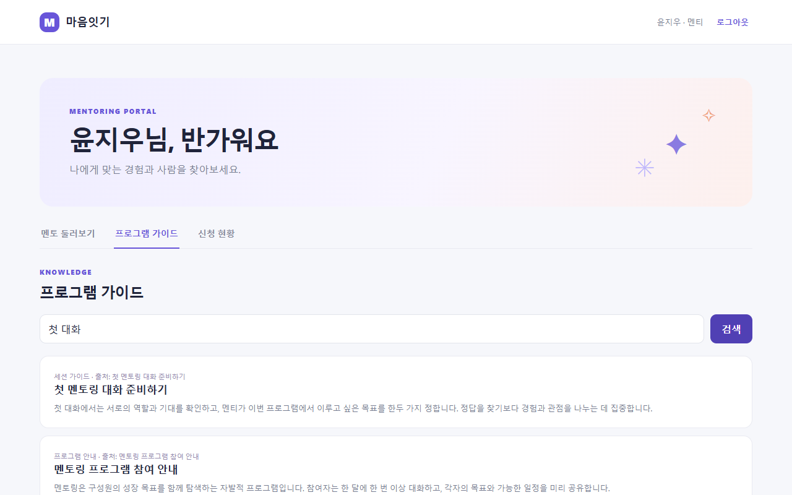
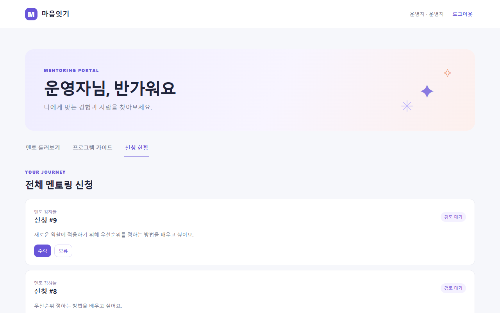
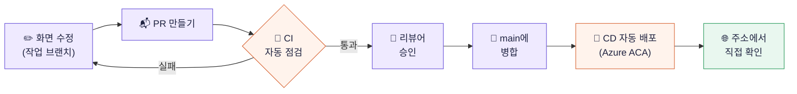

# GitHub Copilot App으로 시작하는 나의 첫 업무 앱

**업무 중 떠올린 “이런 앱이 있으면 좋겠다”를 직접 만들어 보는 실습입니다.** 개발 경험이 없어도 GitHub Copilot App에 원하는 화면과 동작을 설명하고, 캔버스에서 결과를 확인하며 한 단계씩 완성해 갑니다.


## 오늘의 업무 상황: 멘토링 운영을 더 간편하게

**당신은 HR팀의 멘토링 프로그램 담당자입니다.** 구성원들이 부서를 넘어 경험과 지식을 나누도록 사내 멘토링 프로그램을 운영하고 있습니다. 반응은 좋지만 운영은 쉽지 않습니다. 메일이나 설문으로 신청을 받아 엑셀에 옮겨 적고, 관심 분야를 비교해 한 명씩 매칭하며, 신청이 바뀌면 다시 정리합니다. “제 신청은 어떻게 됐나요?”라는 문의에도 일일이 답해야 합니다.

“신청부터 매칭까지 자동으로 처리되는 앱이 있으면 좋겠다”고 생각했지만, 개발 경험이 없어 시작을 망설였습니다. 이번에는 **AI를 개발 파트너로 삼아 이 문제를 직접 해결**해 봅니다.

AI 덕분에 동작하는 화면을 만드는 문턱은 낮아졌습니다. 다만 **화면이 동작하는 것과 사내에서 안심하고 사용하는 것은 다릅니다.** 누가 로그인했는지 확인하고, 신청을 안전하게 저장하고, 본인에게 허용된 정보만 보여 주고, 프로그램 안내를 정확히 찾아주는 과정도 필요합니다. 이 실습에서는 화면 만들기에서 그치지 않고 이런 연결까지 AI와 함께 하나씩 해결합니다.

## 무엇을 만들까요?

이번 주제는 **사내 멘토링 포털**입니다. 빈 화면에서 시작해 로그인, 멘토 탐색, 신청과 운영자 검토 기능을 만들고, 리뷰를 거쳐 다른 사람이 접속할 수 있도록 배포하는 과정을 경험합니다. 목표는 정해진 예제를 똑같이 복제하는 것이 아니라, 이 과정을 통해 **내 아이디어를 설명하고 AI와 함께 실제로 동작하는 앱으로 만드는 방법**을 익히는 것입니다.



필요한 명령 실행과 파일 수정은 가능한 한 GitHub Copilot App에 요청합니다. 여러분은 **무엇이 필요한지 판단하고, 결과가 원하는 대로 동작하는지 확인하는 역할**에 집중하세요.


혼자 회사의 인증 시스템이나 데이터베이스를 구축할 필요는 없습니다. **IT팀이 사용자 인증, 데이터 저장, 사내 지식 검색 서비스와 연동 방법을 제공했다**고 가정합니다. 여러분은 Copilot에게 그 연동 방법을 읽게 하고, 내가 만든 화면에 연결하도록 요청합니다.

실습에서는 실제 사내 서비스 대신 같은 역할을 하는 **목업(교육용 대체 서비스)**과 가상 데이터를 사용합니다. 그래도 로그인 성공, 신청 저장, 권한별 조회, 가이드 검색은 실제로 요청하고 응답받습니다. 화면에 성공 문구만 표시하는 실습이 아닙니다.

| IT팀이 준비한 기반 | 참가자가 처음부터 만들 것 |
|---|---|
| 인증 목업과 가상 계정 | 로그인·로그아웃 화면 |
| 멘토 조회 API와 PostgreSQL DB | 멘토 카드·목록·검색 화면 |
| 신청 저장·조회·운영자 검토 API | 신청 양식·내 신청 현황·운영자 화면 |
| 프로그램 안내·FAQ 검색 API | 가이드 검색창·결과·출처 표시 |
| 자동 갱신 미리보기·CI·ACA 배포 템플릿 | 첫 화면 → 기능 연결 → PR → 배포 |

내가 만드는 화면이 IT팀이 준비한 서비스와 어떻게 연결되는지 그림으로 보면 다음과 같습니다.



**이번 실습의 첫 목표는 신청·조회·운영자 검토까지 작게 완성하는 것입니다.** 신청부터 자동 매칭까지가 최종 아이디어이지만 자동 매칭은 기본 제공 기능이 아닙니다. 먼저 신청과 데이터 연결을 완성한 뒤, 관심 분야·멘토 수용 인원·당사자 동의 등 매칭 기준을 정하고 확장 과제로 발전시킵니다.

완성본은 `examples/mentoring-portal`에 별도로 보관합니다. 막힐 때만 참고하고 내 화면을 완성본으로 덮어쓰지 않습니다.

## 내 업무에도 적용할 수 있나요?

**네. 멘토링 포털은 공통 과정을 배우기 위한 예시입니다.** 핵심은 특정 화면을 똑같이 만드는 것이 아니라, 내 업무의 불편을 설명하고 → 작은 화면을 만들고 → IT팀의 서비스를 연결하고 → 직접 확인하고 → 리뷰와 배포를 거치는 방법을 익히는 것입니다.

| 만들고 싶은 앱 | 같은 방법으로 연결할 수 있는 기능 |
|---|---|
| 신입사원 온보딩 포털 | 로그인 → 가이드 검색 → 개인 체크리스트 저장 |
| 사내 교육 신청 페이지 | 로그인 → 교육 목록 → 신청·승인 현황 |
| 비품·구매 요청 앱 | 로그인 → 요청 작성 → 처리 상태 조회 |
| 팀 업무 가이드 포털 | 로그인 → 업무 문서 검색 → 즐겨찾기·피드백 저장 |

이 저장소의 업무 API와 샘플 데이터는 **멘토링 전용**입니다. 다른 앱을 만들 때는 진행 방법과 인증·저장·검색의 연결 원리를 재사용하되, 해당 업무에 맞는 데이터와 API를 IT팀과 협의하거나 별도로 구현해야 합니다. 회사에 실제 도입할 때도 목업을 실제 서비스로 교체하고 IT팀의 보안·권한·운영 검토를 거칩니다.

## 1. 시작 전에 준비하기

강사가 안내한 GitHub 계정으로 로그인하고, 아래 프로그램을 설치해 주세요. 관리 PC에서 설치가 제한되면 강사/IT 담당자에게 요청합니다.

| 준비물 | 확인 방법 |
|---|---|
| GitHub Copilot App과 사용할 수 있는 Copilot 권한 | 앱에서 GitHub 로그인 후 대화가 가능한지 확인 |
| Git | 강사에게 사전 설치 확인 요청 |
| Docker Desktop | 시작 메뉴에서 실행하고 엔진 준비가 끝날 때까지 기다리기 |
| 웹 브라우저 | Edge 또는 Chrome 등 |

실습용 Node.js, PostgreSQL, 웹 서버는 컨테이너 안에서 실행되므로 참가자 PC에 따로 설치할 필요가 없습니다. GitHub Copilot App의 설치·로그인·권한 승인 창은 사용자가 직접 처리해야 합니다.

### 내 GitHub 저장소 만들기

1. 강사가 공유한 템플릿 저장소를 브라우저에서 엽니다.
2. **Use this template → Create a new repository**를 선택합니다. 버튼이 없으면 강사에게 알려 주세요.
3. 내 계정에 `my-mentoring-portal` 같은 이름으로 저장소를 만듭니다. 공개 여부는 회사의 교육 정책을 따릅니다.
4. 새 저장소의 URL을 복사합니다.

**ZIP 다운로드는 권장하지 않습니다.** ZIP에는 Git 연결 정보가 없어 이후 push와 PR 과정이 더 복잡해집니다. 개인 저장소를 복제(clone)해서 사용하세요. Azure 설정은 템플릿 복사로 함께 복사되지 않으므로 강사가 개인 저장소별로 준비합니다.

### GitHub Copilot App에서 프로젝트 열기

GitHub Copilot App의 프로젝트 추가 기능에서 **내 GitHub 저장소**를 선택하거나 URL로 추가합니다. 로컬 복제 경로를 묻는다면 찾기 쉬운 위치를 선택하세요. 해당 기능이 없으면 강사의 도움으로 저장소를 복제한 뒤 앱에서 그 로컬 폴더를 엽니다.

프로젝트 안에서 **로컬에서 실행되는 세션**을 시작합니다. 클라우드 실행 세션은 내 PC의 Docker와 `localhost`를 사용하지 않습니다. 가능하면 실습 내내 같은 세션을 사용하고, 다른 프로젝트의 컨테이너나 데이터는 건드리지 않습니다.

## 2. 첫 실행은 Copilot에게 부탁하기

프로젝트 채팅에 아래 내용을 그대로 붙여 넣으세요. 명령을 직접 입력할 필요는 없습니다.

```text
나는 비개발자이고 빈 화면부터 멘토링 포털을 만들고 싶어.
README와 저장소 지침을 읽고 현재 작업 폴더를 확인해 줘.
Git, Docker Desktop, Docker Compose가 준비되었는지 확인해 줘.
.env가 없으면 .env.example을 복사하되 기존 설정은 덮어쓰지 마.
docker-compose.yml과 docker-compose.dev.yml을 함께 사용해서
이 프로젝트의 목업과 자동 갱신 미리보기를 백그라운드로 실행해 줘.
이미 실행 중이면 상태를 확인하고 불필요하게 다시 만들지 마.
다른 프로젝트가 쓰는 포트라면 그 프로세스를 종료하지 말고
사용 가능한 포트를 제안해 줘.
시작 화면과 인증·업무 API·Knowledge 상태를 실제로 확인하고
GitHub Copilot App에서 브라우저 미리보기를 열 수 있으면 열어 줘.
불가능하면 내 브라우저에서 열 주소를 알려 줘.
아직 로그인 화면 등 앱 기능을 만들거나 완성본을 복사하지 마.
실행할 수 없다면 원인과 내가 직접 해야 하는 조치만 쉽게 설명해 줘.
```

Copilot이 파일 수정이나 명령 실행 승인을 요청할 수 있습니다. **대상과 내용을 확인한 후 승인**하세요. 첫 실행은 이미지 다운로드 때문에 몇 분이 걸릴 수 있습니다. 문제가 생기면 오류를 숨기지 말고 Copilot에게 확인을 요청하면 됩니다.

기본 접속 주소는 **[http://localhost:8080](http://localhost:8080)** 입니다. 포트를 변경했다면 Copilot이 알려준 주소를 사용합니다.

GitHub Copilot App 안의 **브라우저 캔버스**를 열어 두세요. 캔버스는 채팅 옆에서 만든 앱을 직접 보고 클릭할 수 있는 미리보기 공간입니다. 캔버스를 사용할 수 없는 환경에서는 별도 웹 브라우저를 사용합니다.

처음에는 **“여기서 나만의 앱이 시작됩니다”**라는 문구만 보이는 것이 정상입니다. 미리보기를 열어 둔 채 프롬프트를 입력하면 파일 저장 후 대개 2~3초 안에 자동 갱신됩니다. AI가 코드를 작성하는 시간은 별도로 필요합니다.



*첫 실행 직후의 시작 화면입니다. 이 화면이 보이면 정상입니다.*

### 채팅과 캔버스를 함께 사용하기

| 공간 | 사용하는 방법 |
|---|---|
| 채팅 | 원하는 화면·동작을 설명하고 변경을 요청합니다. |
| 브라우저 캔버스 | 실제 화면을 보고 버튼 클릭, 로그인, 신청을 직접 해봅니다. |
| 문서 캔버스 | README를 열어 다음 실습 단계와 프롬프트를 확인합니다. |

아래처럼 요청하면 됩니다. 캔버스 기능이나 파일 열기가 지원되지 않으면 Copilot이 대체 경로를 안내합니다.

```text
README를 문서 캔버스에 열고, 실행 중인 내 앱을 브라우저 캔버스에 열어 줘.
기존에 열린 미리보기가 있으면 새로 여러 개 열지 말고 그대로 사용해 줘.
나는 채팅으로 요청하고 캔버스에서 직접 결과를 확인하며 진행할게.
```

변경을 요청할 때는 **“지금 보고 있는 첫 화면의 소개 문구를 짧게 해 줘”**처럼 위치와 원하는 결과를 함께 설명하세요. Copilot이 화면을 확인해야 한다면 **“현재 브라우저 캔버스를 확인하고 수정해 줘”**라고 요청할 수 있습니다. 화면에 오류가 보일 때도 민감한 값을 채팅에 복사하지 말고 오류가 발생한 동작을 알려 주세요.

## 3. 첫 프롬프트로 내 화면 만들기

처음에는 외형만 만들고, 다음 단계에서 실제 서비스를 연결합니다. 아래 프롬프트에서 이름·분위기·배치를 원하는 대로 바꿔 보세요. 한 번에 포털 전체를 완성하도록 요청하지 않습니다.

```text
내가 만들 앱은 사내 멘토링 포털이야. 이름은 '함께 자라기'로 해 줘.
app/web의 빈 시작 화면에서 첫 화면을 직접 만들어 줘.
상단에 앱 이름, 가운데에 프로그램 소개와 '멘토 찾아보기' 버튼,
아래에는 참여 방법 3단계를 보여 줘.
깔끔하고 따뜻한 느낌으로, 휴대폰에서도 읽기 쉽게 만들어 줘.
아직 로그인이나 멘토 데이터 기능은 연결하지 마.
버튼을 누르면 '다음 단계에서 멘토 목록을 연결합니다'라고 안내해 줘.
완성본 예제를 복사하지 말고 내 요청에 맞춰 만들어 줘.
자동 갱신 미리보기는 유지하고, 지금은 여기까지만 구현해 줘.
```

**확인:** 시작 문구가 내가 요청한 이름과 첫 화면으로 바뀌었나요? 다음처럼 짧게 대화하며 바꿔도 됩니다.

```text
소개 문구를 더 짧게 하고, 버튼을 더 크게 해 줘.
참여 방법은 카드 3개로 나란히 배치하고 모바일에서는 세로로 보여 줘.
```

> 미리보기는 파일 저장 시 페이지를 새로 불러옵니다. 입력 중인 양식이나 저장하지 않은 화면 상태는 초기화될 수 있으니, 화면 수정을 요청할 때는 작성 중인 입력을 마쳐 주세요. UI 파일 변경에는 재빌드가 필요 없습니다. API나 실행 설정 변경 시에는 Copilot이 해당 서비스만 다시 실행합니다.

## 4. 하나씩 실제 기능 연결하기

> 아래 스크린샷은 `examples/mentoring-portal`의 **완성 예시**로, 각 단계가 끝났을 때의 모습을 짐작하기 위한 참고 자료입니다. 내 화면은 이름·색·배치가 달라도 괜찮습니다. 완성 예시를 내 화면에 덮어쓰지 마세요.

### A. 로그인 만들기

```text
지금 만든 디자인을 유지하며 로그인·로그아웃 기능을 만들어 줘.
docs/instructor-guide.md의 API 계약을 읽고 인증 목업에 연결해 줘.
이메일과 비밀번호를 입력하고 로그인하면 사용자 이름과 역할을 보여 줘.
실패하면 이유를 화면에 표시하고, 비밀번호는 저장하지 마.
내 첫 화면을 완성본으로 교체하지 말고 지금 UI에 기능만 연결해 줘.
```

**로그인에 사용할 계정**

| 역할 | 이메일 | 비밀번호 |
|---|---|---|
| 멘티 | `mentee@demo.local` | `demo123` |
| 멘토 | `mentor@demo.local` | `demo123` |
| 운영자 | `admin@demo.local` | `demo123` |

로그인 화면을 만든 뒤 멘티 계정부터 사용합니다. 이 계정과 고정 토큰은 **인증 목업 전용**이며 실제 회사 계정이 아닙니다.

**확인:** 멘티 계정으로 로그인되고, 틀린 비밀번호에는 오류가 보이나요?



*완성 예시: 로그인 화면*

### B. DB의 멘토 목록 불러오기

```text
로그인한 사용자가 '멘토 찾아보기'를 누르면
업무 API에서 실제 멘토 목록을 받아 카드로 보여 줘.
이름, 직무, 관심 분야, 소개를 표시하고 검색창도 만들어 줘.
로딩 중과 실패했을 때 안내도 보여 줘.
검색 결과가 없으면 검색어를 바꿔 보라는 안내를 보여 줘.
멘토 데이터나 로그인 결과를 브라우저에 하드코딩하지 마.
```

**확인:** DB의 가상 멘토가 보이고 이름·관심 분야로 검색되나요?



*완성 예시: 로그인 후 멘토 카드 목록*

### C. 신청하고 저장하기

```text
멘티가 멘토 카드에서 신청 버튼을 누르면 목표 입력창을 열어 줘.
목표는 공백만 입력할 수 없고 1,000자까지 입력 가능하게 해 줘.
전송 중에는 중복 제출을 막고 실패하면 이유를 화면에 보여 줘.
신청을 실제 API로 저장하고 내 신청 현황을 다시 조회해서 보여 줘.
새로 고침 후에도 DB에 저장된 신청을 확인할 수 있게 해 줘.
```

**확인:** 신청한 뒤 새로 고침해도 신청 기록이 남아 있나요?



*완성 예시: 멘토 카드의 신청 버튼을 누르면 열리는 목표 입력 창*



*완성 예시: 신청 후 내 신청 현황*

### D. 사내 가이드 검색하기

```text
Knowledge 목업을 이용해 프로그램 가이드 검색 화면을 만들어 줘.
검색 결과에는 제목·내용·출처를 표시해 줘.
검색 중·결과 없음·서비스 오류도 구분해서 안내해 줘.
AI 답변이나 검색 결과를 임의로 만들지 말고 실제 검색 API를 사용해 줘.
```



*완성 예시: `첫 대화` 검색 결과. 제목·내용·출처가 함께 표시됩니다.*

### E. 운영자 화면 만들기

```text
운영자 계정으로 로그인하면 전체 신청 목록을 보여 줘.
운영자가 신청을 수락하거나 거절하고 그 상태를 API로 저장하게 해 줘.
멘티에게는 본인 신청 현황만 보이게 하고,
운영자 버튼을 숨기는 것뿐 아니라 API의 권한 검사도 유지해 줘.
```



*완성 예시: 운영자 계정에서 보이는 전체 신청 목록과 검토 버튼*

프로필 편집, 일정 관리, 자동 매칭은 별도의 확장 과제입니다. 기본 기능을 완성한 뒤 추가하세요.

## 5. 원하는 대로 동작하는지 확인하기

아래 동작을 브라우저에서 직접 해보세요. Copilot의 “완료”라는 답변만으로 확인을 대신하지 않습니다.

| 확인할 것 | 기대 결과 |
|---|---|
| 멘티 로그인 | 멘토 목록이 보임 |
| 멘토링 목표 작성 후 신청 | 신청 현황에 새 신청이 표시됨 |
| 브라우저 새로 고침 | 저장한 신청이 유지됨 |
| 프로그램 가이드에서 `첫 대화` 검색 | 안내 내용과 출처가 표시됨 |
| 로그아웃 후 운영자 로그인 | 전체 신청을 확인하고 수락할 수 있음 |
| 멘티로 다시 로그인 | 운영자가 변경한 상태가 표시됨 |

추가로 자동 확인을 요청할 수 있습니다.

```text
내가 만든 화면과 로그인·멘토 조회·신청 저장·운영자 검토·
Knowledge 검색이 실제로 연결되었는지 확인해 줘.
로컬 Node.js가 없어도 실행 중인 컨테이너를 이용해서
저장소의 scripts/smoke-test.mjs를 실행할 수 있는지 확인해 줘.
실행했다면 결과를 알려 주고, 실행하지 못한 항목은 명확히 구분해 줘.
테스트 중 데모 신청 데이터가 추가된다면 미리 알려 줘.
```

자동 테스트는 가상의 멘토링 신청을 하나 만들고 수락합니다. 기존 실습 데이터를 삭제하지는 않습니다. 이 테스트는 **서비스 연결을 확인하며, 참가자가 UI를 완성했는지까지 판정하지는 않습니다.** 위 표의 화면 동작과 모바일 사용성은 별도로 직접 확인하세요.

## 6. GitHub에 제출하기

**push**는 내 작업을 GitHub로 보내는 것이고, **PR(Pull Request)** 은 변경사항을 리뷰해 달라는 요청입니다. 처음부터 `main`에 직접 올리지 말고 작업 브랜치로 제출합니다.

```text
내 변경사항을 GitHub 리뷰에 제출하고 싶어.
현재 저장소 연결과 작업 브랜치, 변경 파일을 먼저 확인해 줘.
이미 작업 브랜치라면 그대로 사용하고 main이면 별도 브랜치를 만들어 줘.
.env나 비밀값, 불필요한 파일이 포함되지 않았는지 확인해 줘.
변경사항을 쉬운 말로 요약하고 필요한 검증을 해 줘.
내 작업만 커밋하고 내 저장소에 push한 뒤 main을 대상으로 PR을 만들어 줘.
PR 설명에는 바뀐 화면, 확인한 동작, 아직 확인하지 못한 점을 적어 줘.
main 병합이나 Azure 직접 배포는 하지 마.
로그인이나 권한 승인이 필요하면 내가 해야 하는 단계를 알려 줘.
```

GitHub Copilot App의 GitHub 연동이나 저장소 권한이 부족하면 브라우저 로그인 등이 필요할 수 있습니다. 비밀번호나 토큰을 채팅에 붙여 넣지 마세요. PR 자동 생성이 불가능하면 Copilot이 알려준 브랜치로 push한 후 GitHub 저장소에서 **Compare & pull request**로 생성합니다.

## 7. 리뷰 후 배포된 앱 확인하기

PR의 **Checks**에서 CI 결과를 확인하고 강사 또는 지정된 리뷰어에게 리뷰를 요청합니다.

| 용어 | 이 실습에서 하는 일 |
|---|---|
| CI | 빌드·서비스 실행·기본 기능 자동 확인 |
| 승인 | 리뷰어가 변경을 확인하고 동의 |
| 병합(Merge) | 승인된 변경을 main에 반영 |
| CD | main 변경을 Azure ACA에 배포 |

**승인만으로 배포되지는 않습니다.** 강사가 설정한 병합 조건을 충족한 PR을 main에 병합하면 CD가 시작됩니다. 본인이 작성한 PR을 스스로 승인할 수는 없으므로 리뷰어가 필요합니다.



보라색은 사람이 하는 일, 주황색은 자동으로 실행되는 일입니다. 실패하면 오류 단계를 확인해 고친 뒤 같은 PR에 다시 올리면 CI가 다시 실행됩니다.

강사가 Azure와 GitHub 설정을 완료한 저장소에서만 자동 배포가 동작합니다. 배포 워크플로의 **Show deployed portal URL** 단계에서 주소를 확인하거나 아래처럼 요청하세요.

```text
내 PR과 GitHub Actions의 CI/CD 결과를 확인해 줘.
실패했다면 어느 단계에서 무엇이 실패했는지 쉽게 설명해 줘.
배포가 끝났다면 ACA 접속 주소를 알려 줘.
아직 병합되지 않았다면 직접 병합하지 말고 현재 상태만 알려 줘.
권한 때문에 볼 수 없다면 GitHub에서 내가 확인할 위치를 안내해 줘.
```

배포된 주소에서도 로그인과 화면 동작을 확인합니다. **로컬 DB와 ACA DB는 별개**이므로 로컬에서 만든 신청이 배포 환경으로 복사되지는 않습니다.

자동 갱신 미리보기는 로컬 개발 전용입니다. ACA에는 내가 만든 UI 파일을 이미지로 빌드해 배포하므로, 배포된 앱의 변경은 다시 PR·병합·배포해야 반영됩니다.

## 8. 실습 종료와 다시 시작

### 데이터는 남기고 종료하기

```text
이 프로젝트의 개발용 Compose 구성으로 실행한 서비스만 종료해 줘.
DB 볼륨과 저장한 데이터는 삭제하지 마.
다른 프로젝트의 컨테이너나 Docker Desktop 전체는 종료하지 마.
```

다시 시작할 때는 2단계의 첫 실행 프롬프트를 사용하면 됩니다.

### 문제가 생겼을 때

```text
지금 포털이 정상 동작하지 않아.
이 프로젝트의 개발용 Compose 상태와 최근 로그, 웹 라우팅을 확인해 줘.
UI가 자동 반영되지 않으면 docker-compose.dev.yml을 함께 사용 중인지,
app/web이 미리보기 컨테이너에 연결되어 있는지 먼저 확인해 줘.
DB 삭제나 초기화 없이 원인을 찾아 수정하고 필요한 서비스만 다시 빌드해 줘.
내가 직접 승인하거나 확인해야 하는 것이 있으면 쉽게 알려 줘.
```

데이터를 모두 지우고 처음부터 시작하고 싶다면 별도로 **“이 프로젝트의 로컬 실습 데이터 초기화”**를 요청하세요. 삭제 대상과 영향을 설명받고 승인한 뒤에만 초기화합니다. **Azure 리소스 종료·삭제는 강사에게 요청**합니다. 로컬 서비스 종료만으로 Azure 비용이 멈추지는 않습니다.

## 강사·IT 담당자 안내

교육 전 설정, Azure 변수·권한, 서비스 구조와 수동 명령 참고는 **[강사 준비 안내](docs/instructor-guide.md)**에 있습니다. 참가자는 위 순서만 따라가면 됩니다.
